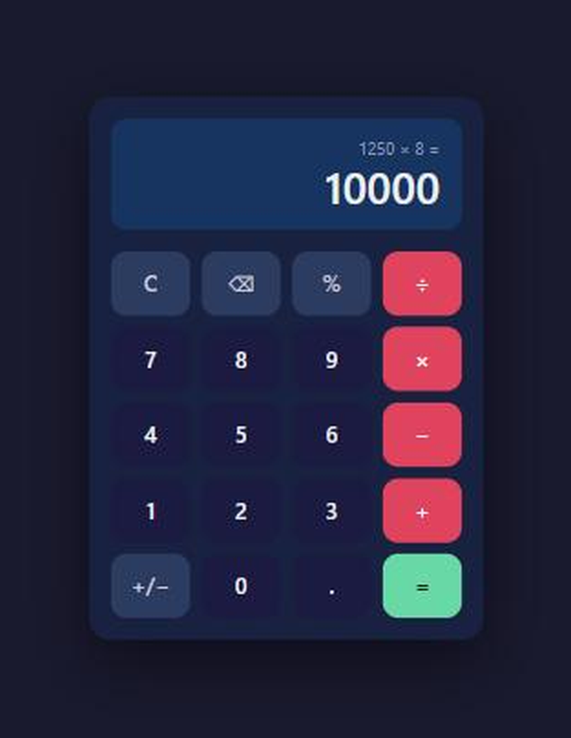

# Calculator

A clean, responsive calculator web app built with vanilla HTML, CSS and JavaScript — no frameworks, no build step, no dependencies.

**[→ Try it live](https://dacheson.github.io/simpleCalc/)**



## Features

- Standard arithmetic: addition, subtraction, multiplication, division
- Decimal, percentage, and positive/negative toggle support
- Chained operations with a running expression display
- Full keyboard support (numbers, operators, Enter, Backspace, Escape)
- Error handling for divide-by-zero and invalid input
- Dark theme with smooth button animations
- Responsive down to mobile widths

## Running locally

No tooling required — the app is three static files.

```bash
git clone https://github.com/dacheson/simpleCalc.git
cd simpleCalc
python -m http.server 8000   # or: npx serve .
```

Then open <http://localhost:8000>.

Opening `index.html` directly in a browser also works.

## Project structure

```
index.html    markup and button grid
style.css     dark theme, layout, button states
script.js     input handling, expression state, evaluation
```

## Deployment

Deployed to GitHub Pages by the workflow in `.github/workflows/`, which publishes the repository root on every push to `main`. No build step runs.

## Licence

[MIT](LICENSE)
